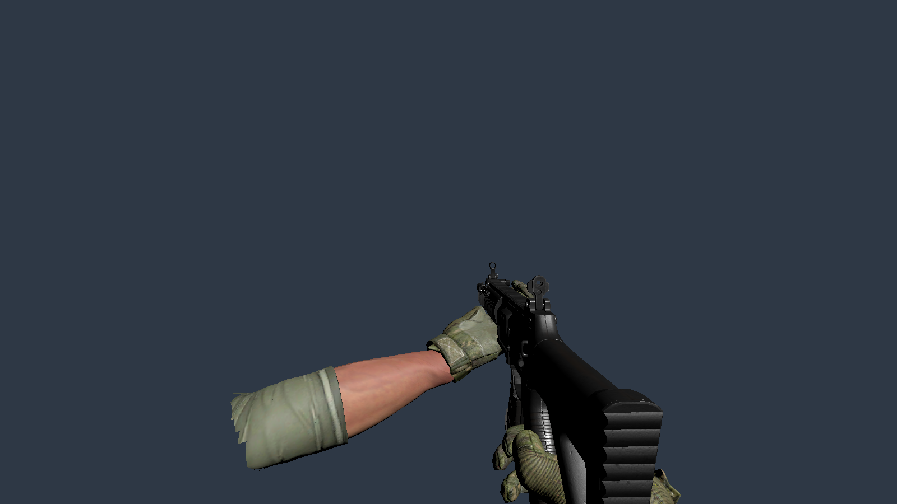
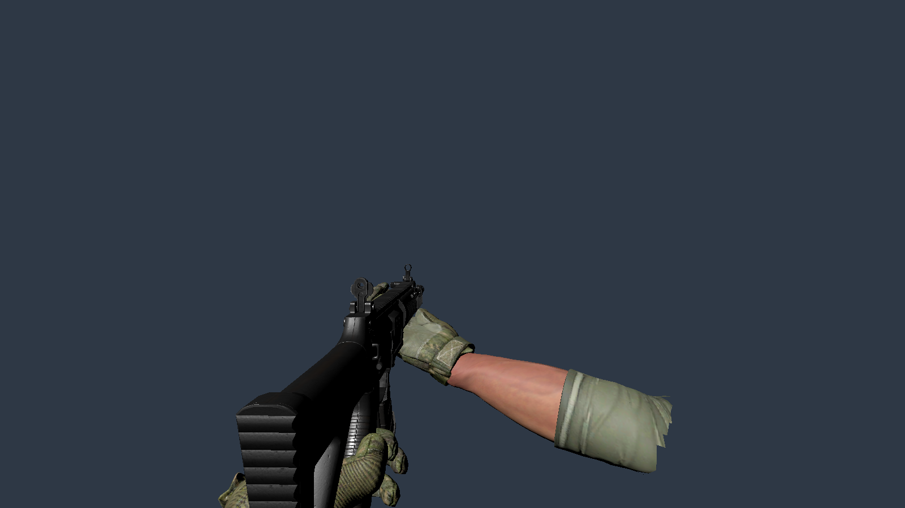
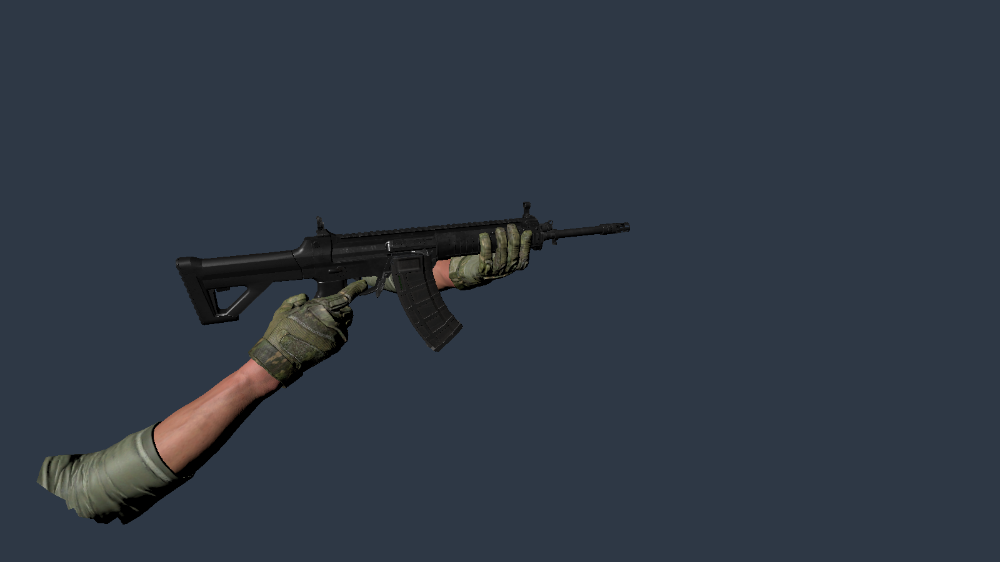
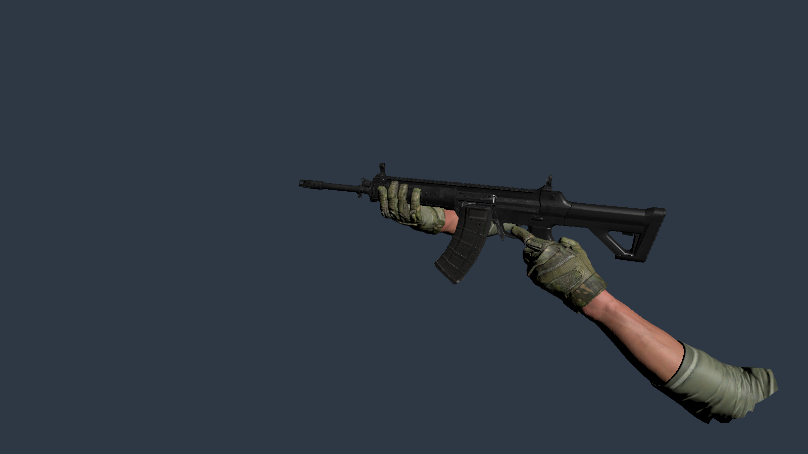
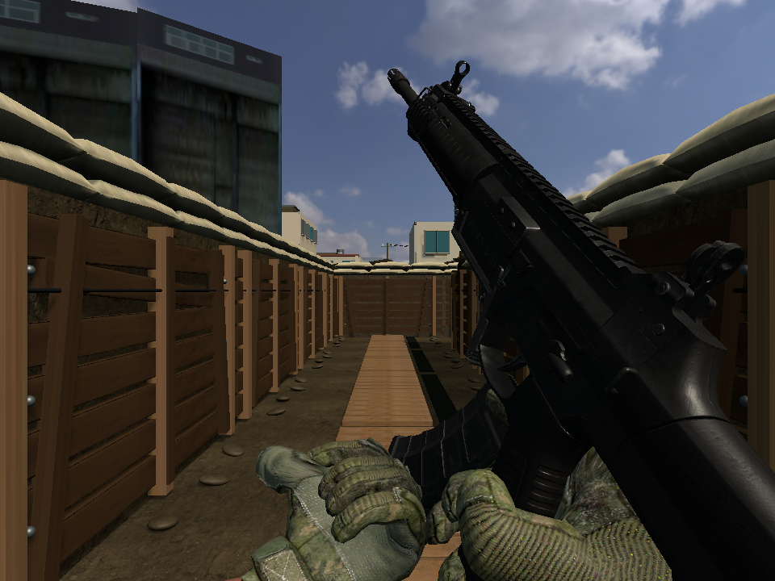
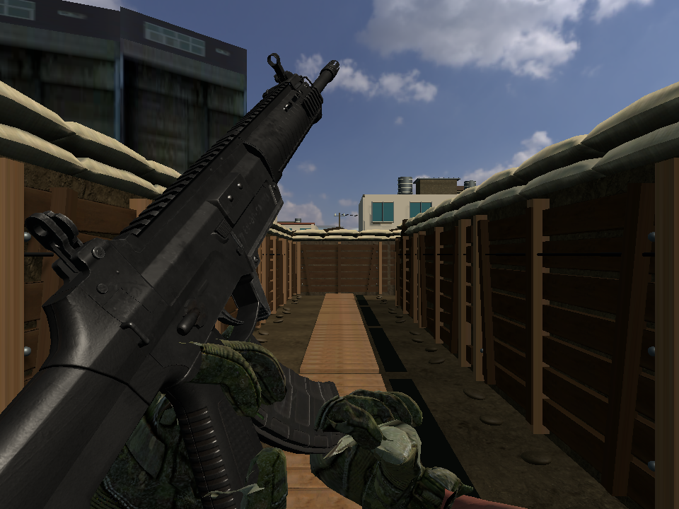
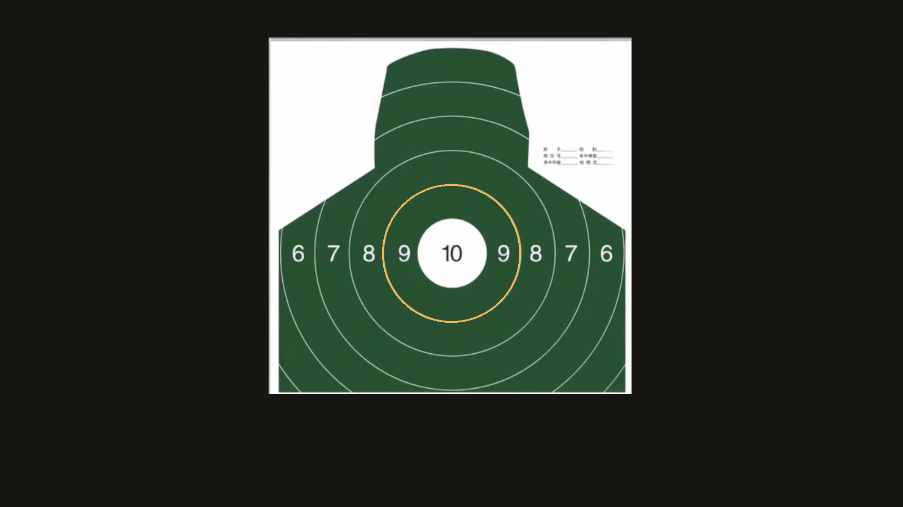
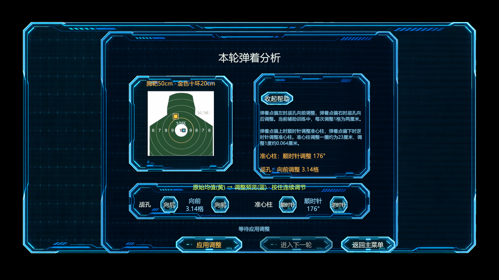

> 历史交付记录：用户随后要求撤回PR #28的模式一、二改动。下文P1/P2行为、截图与测试结论仅代表撤回前版本，当前状态见 `2026-10-22-revert-pr28-p1-p2.md`。模式三、四改动保留。

# 2026-10-22 训练辅助与镜像左肩持枪

分支：`codex/range-assist-mirrored-left-shoulder`；基线：`54073a0`。实现和完整回归已完成：EditMode 339/339、PlayMode 254/254。PR面向main；VR实机舒适度仍按下文清单待验，不冒充头显实测。

权威规格：[BDD29](../BDD/screens/29-训练辅助与镜像左肩持枪.feature.md)、[接口21](../接口文档/21-训练辅助与镜像左肩持枪.md)。沿用P1玩法/场景task005/006/012/013、UI task008/009/010/017，P2 task006/007、P3 task004/019/020；不增加AI或训练阶段范围。

## 实现与证据

| 用户要求 | 本轮实现 | 已验证证据 |
|---|---|---|
| 模式一水平每次1格 | 按钮短按/长按每步调用一次命令，每格2cm，保留原水平范围；垂直每步1度不变；帮助和控件都显示当前待应用补偿 | 服务/UI回归验证水平+2cm、垂直-0.064cm；保留垂直多圈，修复帮助中的旧方向/整数格建议 |
| 弹着补偿实际生效 | 将预览的有符号厘米补偿恰好一次加入后续有效偏移；历史点不变，同轮应用幂等 | 旧实现只记账的回归先失败；相同枪线下一轮弹孔、曳光与评分均消费同发服务结果 |
| 更小初始偏移、更大十环 | 固定种子半径3–8cm，辅助十环半径10cm（包含边界） | 100个种子的范围/复现性、圆形边界与靶外不吸附测试；金色20cm边界的场景/UI真实渲染网格测试 |
| 模式一/二更近 | 实际靶位前移至25m/50m，保留出生点、正前方枪架/UI；P2仍40m路线 | 保存场景测试先测得99.688m/100m，迁移后25m/50m；场景构建流程也调用迁移 |
| 模式三额外5血/5枪 | 默认玩家5→10，敌人每发1伤害不变；城镇仍5，自定义配置保留 | 第5枪后5血、第9枪后1血，第10枪死亡及新局复位；生产模式初始化验证MaxHealth 10/5 |
| 全模式右B切肩、换扳机手 | B按下沿切换，左右后握把/支撑角色、扳机、跟踪、震动和换弹锁定同步；切换取消旧连射并重新武装；同帧双握把也能构成左肩双手持枪 | 四模式真实InputSystem B/扳机到生产服务和枪械的集成测试，右扳机不能触发左肩射击，切回已按住扳机不耗弹；真实XRI选择后握把优先交换，支撑手锁定只取消当前支撑手 |
| 手臂/手指完整镜像 | 镜像原始网格、绑定矩阵、骨架和指骨；不用负缩放的蒙皮世界变换；不修改原始共享模型 | 左右原始手分别3217/3252个顶点、34个变换/20个蒙皮骨骼全部反射，误差小于0.1mm；切回精确还原 |
| 左肩换弹 | 原支撑角色镜像到右手；弹匣枢轴/倾角和换弹锚点使用同一镜像坐标系，完成/取消恢复当前控制器 | 关键姿态0.25/0.50/0.85的真实蒙皮顶点和弹匣仿射姿态镜像；VR替身中途切肩恢复新控制器 |

## 已运行回归

环境：Windows，Unity 2022.3.62f3c1；输入使用无头显可运行的InputSystem XR虚拟设备、真实场景/Prefab和服务。图形测试启用图形后端，不用示例HUD数据代替生产数据。

| 迭代运行名（Temp会在Editor重启时清理；最终XML见下文持久化链接） | 结果 |
|---|---:|
| range-assist-mirror-green-3.xml | EditMode 4/4 |
| range-assist-role-green.xml | PlayMode 6/6 |
| range-assist-combat-wiring-green.xml | PlayMode 4/4 |
| range-assist-reload-mirror-green.xml | PlayMode 8/8 |
| range-assist-distance-green.xml | EditMode 9/9 |
| range-assist-ten-ring-green.xml | EditMode 20/20 |
| range-assist-ui-copy-green.xml | PlayMode 8/8 |
| range-assist-all-mode-input-green.xml | PlayMode 23/23 |
| range-assist-full-edit-green.xml | 完整EditMode 338/338 |
| range-assist-approved-pose-and-aim.xml | EditMode 5/5，新增非零偏航枪线与已批准右肩姿态保护 |
| range-assist-xr-framing-and-render.xml | PlayMode 9/9 |
| range-assist-simultaneous-grips-green.xml | PlayMode 10/10 |
| range-assist-pending-help-green.xml | PlayMode 10/10 |
| 最终EditMode（持久化XML） | 339/339 |
| 最终PlayMode（持久化XML） | 254/254 |

以上迭代运行有重叠，不能相加冒充独立用例总数。最终完整结果：[EditMode XML](evidence/range-assist-shoulder-20261022/editmode-results.xml)、[PlayMode XML](evidence/range-assist-shoulder-20261022/playmode-results.xml)。

完整EditMode首轮338项中302通过、36失败，已逐项修订旧期望。除本轮改变的25m/10血/真实补偿外，测试替身仍只提供5个堑壕出生候选，违反基线已有的BDD24修订（5–7敌人、至少7候选）；现只补齐测试数据和边界用例，未改生产AI生成数量。垂直方向枚举沿用基线最新恢复契约，不改为另一套机械规则。

完整PlayMode首轮254项中231通过。旧场景/手部用例仍依据100m、5血或早于已批准资源的腕/指角度；现以真实距离、服务最大生命及已批准接触点/指节方向验证。XR用例统一在真实BeforeRender阶段采集基线，校正输入替身的枪架附着旋转后再朝前瞄准；检测手掌可见及真实蒙皮网格与视锥相交，不再误把长前臂网格中心当成手掌。没有放宽镜像0.1mm、抓取稳定5mm等门禁。

## 原生渲染对照

下列均由仓库保存的真实模型、材质和运行时镜像组件生成，不是AI概念图。没有重新雕刻、改姿或覆盖原右肩手部Prefab；静态握姿同时受到已批准接触偏移/旋转和20段指节接触方向回归保护。编辑器证据使用烘焙后的同帧真实蒙皮；换弹证据直接来自PlayMode的实际SkinnedMeshRenderer。

| 右肩 | 左肩 |
|---|---|
|  |  |
|  |  |
|  |  |

辅助十环保留原照片50cm命中坐标标定，以直径20cm金圈表示新的辅助范围；原照片白色10cm圆不作为本轮判定边界。Unlit材质显式设置金色，避免只有线条顶点色但实际渲染仍为白色。

保存场景玩家视角：[P1 25m](evidence/range-assist-shoulder-20261022/p1-player-25m.png)、[P2 50m](evidence/range-assist-shoulder-20261022/p2-player-50m.png)。

复现静态渲染：保存当前场景后，Unity菜单 `Tools/Simulated Shooting/Capture Training Assistance Evidence`；或在Editor关闭时用batchmode调用 `SimulatedShooting.Editor.RangeAssistanceEvidence.Capture`。该工具不保存或重写姿态/场景，仅生成对照PNG。PlayMode运行 `CombatMagazineReloadPlayModeTests`、`Screen06_ZeroingImpactAnalysisUITests` 可重新采集GPU换弹及UI画面。

## 实机待验与边界

- 未连接头显，未声称完成VR实机验收。需要检查右B切肩、左扳机/右支撑的自然操作，机瞄、腕肘舒适度和UI可读性。
- 检查左右肩抓取/释放和换弹时的支撑手恢复，尤其是手部丢失跟踪、换弹中切肩以及重新抓握。
- 固定射击位仍禁止人工移动/传送；HMD和控制器跟踪变换不缩放、不被镜像代码改写。
- 模式ID `Zeroing100m`、场景ID及历史目录保留兼容；面向玩家的距离显示采用当前辅助距离。
- 开工前已有的VFX、Plugins、ProBuilder和日志不属于本轮，不应混入提交。Unity导入产生的无关XR/Sample Prefab序列化变化也不应混入。
