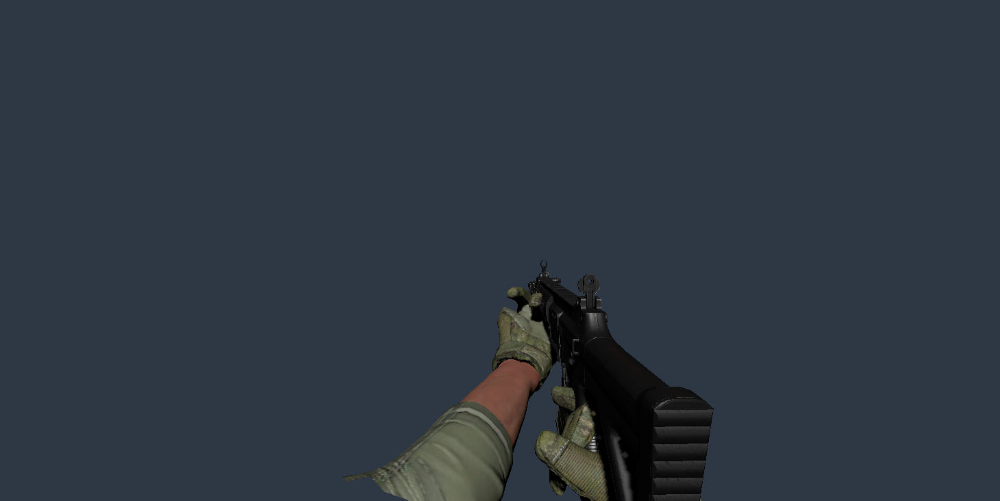
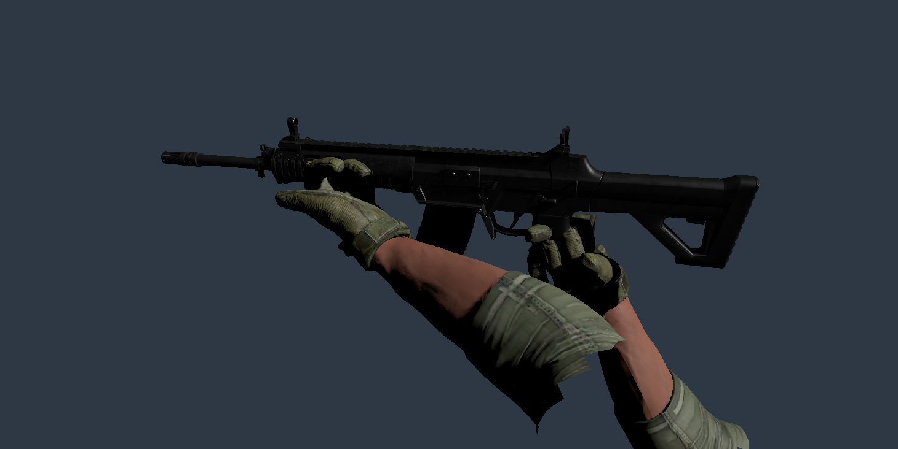

# 审核图对应的握枪姿势调整

2026-10-20；P3场景task014 / BDD23 / 接口11的用户审核握枪姿势补充。

## 修改

依据用户确认的[正前方参考图](evidence/approved-forward-grip/approved-reference.png)，在实际步枪模型旁重新配置新手模型。旧配置沿用旧手模型的坐标约定，是换新模型后握持朝向异常的原因之一。

- 右手位于后握把外侧，掌部转向握把，三指弯曲，食指改朝扳机护圈前方；拇指单独配置对掌方向。
- 左手从前护木下方承托，调整前臂上抬与内收角度，并单独配置拇指。
- `VirtualHand_Left/Right.prefab`保留原GUID，写入新的握持偏移、旋转与手指角度。
- 模式一、二场景中的内置手模型同步新配置；主菜单及P3动态创建入口继续读取共享资源。
- 场景生成工具经`ModularGlovedArmsAuthoring.PatchSceneHands`复制共享资源的握持位置、旋转与手指配置，避免重新生成时恢复旧参数。
- 仅修改表现配置及编辑器工具，没有改动头显/手柄跟踪、射击输入或换弹状态机。枪口朝向仍由实际手柄持枪方向决定，不锁定相机或强制把枪移到屏幕中央。

## 保存的握持参数

单位为握把Anchor局部坐标米/度；完整手指角度见`ApprovedForwardGripAuthoring.Configure`。

| 手 | 位置偏移 | 旋转偏移 |
|---|---|---|
| 左 | (-0.0442,-0.0526,-0.0418) | (-20,25,180) |
| 右 | (0.0387,-0.0107,-0.0164) | (-60,-15,-90) |

## 检查及未验范围

- 已保存共享Prefab和两个场景，两手各保留15个可识别手指关节。
- Unity编译无失败，无`error CS`；已查看实际模型的前方、侧面与手部细节渲染。
- 截图为编辑器中的姿势预览，使用现有握姿入口和`SkinnedMeshRenderer.BakeMesh`，静态快照只存在于未保存的临时场景，未替换运行时蒙皮。
- 本次未新增或运行自动化测试，未代替真实头显验收。头显内仍需确认手腕舒适度、不同持枪角度下的贴合、松手恢复及换弹结束恢复；获授权后再补现有手部/换弹PlayMode回归。
- 收尾关闭临时预览，编辑器恢复MainScene且停止播放。

