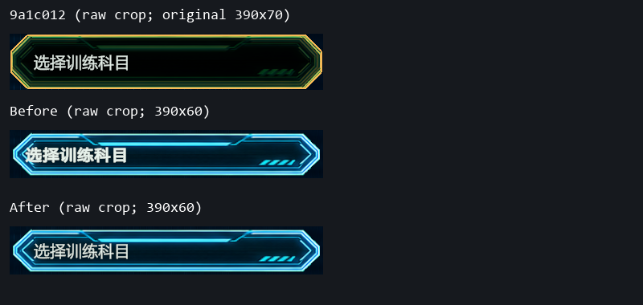

# 主菜单“选择训练科目”字体恢复（2026-11-17）

已恢复为独立worktree中`9a1c01224a7e87ed84c6d54fe47cec4e46d5422a`的字形效果。实测117×20px、左内缩30px、右侧剩余243px，与基线误差均为0；相同黑底、按面板中心对齐后的全部字形RGB像素差异为0。标题条继续使用hud_capsule、Color.white、无Outline，坐标(1360,805)–(1750,865)。

**渲染流程与原始基准**

使用Unity 2022.3.62f3c1，在独立detached worktree `E:/SimulateShooting-heading-font-9a1c012`检出指定提交；主工作区HEAD和分支保持原状。同一份[截图脚本](evidence/mainmenu-heading-font-2026-11-17/capture.ps1)和[C#渲染源](evidence/mainmenu-heading-font-2026-11-17/HeadingFontEvidence.cs.txt)分别渲染基线、开工版本、单变量探针和最终版本。脚本沿用上一单TacticalUIGallery.Create → MainMenuUI.Initialize → PreviewScene → WorldSpace Canvas → Camera.Render流程，1920×1080、RGB24、1设计单位=1像素；未重绘原始截图。所有Unity实例串行运行。

指定提交及11月15日认可截图的标题条实际位于(1360,667)–(1750,737)，PNG区域为x1360..1749、y343..412；当前标题条按用户指定坐标保留，PNG区域为x1360..1749、y215..274。11月12日原版标题条PNG区域为y215..284。比较以各自面板左边缘为原点；字形单独渲染后只按面板中心对齐，不修改任何基线源码或原始全景布局。两版70px/60px高度相差10px，比较黑底字形时在当前面板上下各补5px黑底。

量化规则：在标题条内部x18..179、y15..高度−16的文字搜索窗口，取min(R,G,B)≥80且max(R,G,B)−min(R,G,B)≤45的墨迹像素，避免蓝色边框；亮度L=0.2126R+0.7152G+0.0722B，亮像素为L≥200。亮像素占比的分母是字形包围盒面积。笔画宽度代理=2×墨迹面积/四邻接数字周长，作为同条件的粗细比较指标。右侧剩余指最后一个字形像素到面板右边缘的空白，不等同于RectTransform右padding。

**原始全景的量化比较**

| 图像 | 字形宽×高(px) | 左内缩 / 右侧剩余(px) | 墨迹像素 / 亮像素 | 亮像素占包围盒 | 平均墨迹亮度(0–255) | 笔画宽度代理(px) |
|---|---:|---:|---:|---:|---:|---:|
| worktree 9a1c012 | 117×20 | 30 / 243 | 1291 / 484 | 20.6838% | 178.4276 | 2.351548 |
| 11月15日认可截图 | 117×20 | 30 / 243 | 1291 / 484 | 20.6838% | 178.4276 | 2.351548 |
| 11月12日原版截图 | 117×20 | 30 / 243 | 1291 / 484 | 20.6838% | 179.0441 | 2.351548 |
| 本轮修复前 | 126×20 | 19 / 245 | 1839 / 1097 | 43.5317% | 201.9035 | 4.877984 |
| 本轮修复后 | 117×20 | 30 / 243 | 1291 / 490 | 20.9402% | 179.3908 | 2.351548 |

本轮修复前图与用户指出的11月16日问题图量化结果完全一致。基线与两个认可参考的宽度、高度、左右空白、墨迹像素数、亮像素数及笔画宽度代理互相印证。完整数据见[font-measurements.json](evidence/mainmenu-heading-font-2026-11-17/font-measurements.json)。

新版面板保留蓝色原色，旧版面板为暗色tint；抗锯齿边缘与不同底色混合后，原始全景平均墨迹亮度相差0.9632/255，亮像素占包围盒相差0.2564个百分点。将文字通过同一相机单独渲染到相同黑底，得到以下结果，所有量化项严格一致：

| 图像 | 字形宽×高(px) | 左内缩 / 右侧剩余(px) | 墨迹像素 / 亮像素 | 亮像素占包围盒 | 平均墨迹亮度(0–255) | 笔画宽度代理(px) |
|---|---:|---:|---:|---:|---:|---:|
| worktree 9a1c012，同底字形 | 117×20 | 30 / 243 | 1291 / 484 | 20.6838% | 178.4276 | 2.351548 |
| 修复前，同底字形 | 126×20 | 19 / 245 | 1846 / 1076 | 42.6984% | 200.8442 | 4.896552 |
| 修复后，同底字形 | 117×20 | 30 / 243 | 1291 / 484 | 20.6838% | 178.4276 | 2.351548 |

基线与最终版按中心对齐的390×70同底图，changed_pixels=0、max_channel_delta=0。TMP六字逐字的bottomLeft/topRight也完全一致，原始记录见[基线组件检查](evidence/mainmenu-heading-font-2026-11-17/baseline-9a1c012/gallery-inspection.txt)、[最终组件检查](evidence/mainmenu-heading-font-2026-11-17/after/gallery-inspection.txt)及[逐像素审计](evidence/mainmenu-heading-font-2026-11-17/pixel-verification.json)。

**定位与最终改动**

基线和当前AddPanel的源参数相同：AddLabel(...,20,FontStyles.Bold,Left,(20,18),(-20,-18),...)。AddLabel首先剥离Bold、设Regular、extraPadding=true；TacticalUIStyle.Apply随后保留Normal并将extraPadding=false，小面板文字内边距改成(30,4)至(-30,-4)。基线最终是Normal/Regular，而开工版本在共用样式之后又强行恢复Bold及(20,18)偏移，造成增粗和左移。

单变量探针先仅将Bold改为Normal，实测宽117px、高20px、左内缩20px、右侧剩余253px、亮像素占比20.9829%，验证增粗/增宽来自合成Bold，剩余10px左移来自标题专用偏移。最终生产代码只在MainMenuUI.cs删除该标题专用覆盖块10行，恢复基线共用流程；未改字号、颜色、fontWeight或共用样式。

恢复后文字容器从350×24变成330×52，基线Ellipsis模式下isTextOverflowing=false、六个字形均可见，省略号没有替换标题。生产代码中其它入口、状态条、介绍页、边框和面板坐标均无本轮修改。相对开工快照的精确差异见[task-changes.diff](evidence/mainmenu-heading-font-2026-11-17/task-changes.diff)。同步更新的文档为BDD02、接口01与P1/UI task008；DTO、命令和事件无变化。

**断言新旧对照**

EditMode保留完整fullname `VRShooting.Tests.EditMode.Application.MainMenuControlsTests.Bdd02_HeadingUsesPrimaryVisualWithoutInteractionAndEntriesUseSecondaryVisual`；PlayMode保留 `VRShooting.Tests.PlayMode.UI.Screen02_04_MainMenuZeroingBriefingUITests.Screen02_CreatorsEntryAndPanelAreAbsentAndNavigationRemainsUsable`。相对开工源码，仅标题相关断言有以下有意变化；其它断言保留。

| 断言 | 开工时 | 本轮最终 |
|---|---|---|
| fontStyle（两平台） | Bold | Normal，与9a1c012实际输出一致 |
| offsetMin / offsetMax（两平台） | (20,18) / (-20,-18) | (30,4) / (-30,-4) |
| fontWeight | EditMode已有Regular；PlayMode未检查 | 两平台检查Regular |
| extraPadding | 未检查 | 两平台检查false |
| 六字可见 | 两平台检查6个可见字形 | 保留；说明文字同步为恢复后的容器 |
| isTextOverflowing | 未检查 | 两平台检查false，禁止省略掉标题 |
| 实际字形栅格 | 未检查 | EditMode用Camera.Render真实渲染390×60标题文字，验证存在墨迹、宽117±1px、高20±1px、左30±1px、右243±1px |
| 粗细保护 | 未检查 | EditMode亮墨迹/全部墨迹=484/1291，容差±0.015；注释写明基线实测值 |
| 标题面板、字体大小/颜色/对齐 | hud_capsule、Sliced、white、无Outline、固定坐标；20号、原色、左对齐 | 全部保留 |

回归测试先于修复加入：[editmode-raster-red.xml](evidence/mainmenu-heading-font-2026-11-17/editmode-raster-red.xml)为15通过/1失败，准确报出左内缩期望30±1、实际19；[初次修复测试](evidence/mainmenu-heading-font-2026-11-17/editmode-targeted.xml)中栅格断言通过，但测试清理未解除Camera.targetTexture产生Unity错误，随后补齐finally清理并在最终定向/全量测试中通过。

**前后影响范围证明**

| 比较对象 | 变化像素数 |
|---|---:|
| 主菜单全景 | 2226，全部位于x1379..1506、y236..255的标题文字区域 |
| 标题条区域以外的全部全景像素 | 0 |
| 01、02、03、04各自整行入口 | 各0 |
| 底部状态条 | 0 |
| 隐藏标题文字后的整张主菜单（包含标题边框/内芯） | 0 |
| 模式一、二、三、四介绍页各自完整画面 | 各0 |

上述均按未经处理的PNG RGB像素比较。[verify-pixels.py](evidence/mainmenu-heading-font-2026-11-17/verify-pixels.py)可独立复算，[pixel-verification.json](evidence/mainmenu-heading-font-2026-11-17/pixel-verification.json)保存全部结果；四页介绍的before/after原图也已保留。

**测试与指定基线逐条比较**

最终EditMode定向：16条：16通过 / 0失败。相关UI、输入和P1流程PlayMode定向：64条：64通过 / 0失败。两平台全量结果如下：

| 平台 | 用户指定11月15日基线 | 本轮全量 | 新增失败 | 失败集合逐条同名 |
|---|---|---|---:|---|
| editmode | 403：384通过/19失败 | 412：393通过/19失败 | 0 | 是 |
| playmode | 333：312通过/21失败 | 336：315通过/21失败 | 0 | 是 |

主基线严格使用`mainmenu-heading-border-2026-11-15/editmode-full.xml`与`playmode-full.xml`原始文件。按完整fullname比较，不做别名、参数归一化或失败豁免。保留的共同fullname状态变化为0；40个失败逐条同名。全量仍有这些既有失败。

开工时已有11月16日介绍页/布局改动，因此相对11月15日基线，存在以下四个通过用例的参数fullname变化。它们在本轮开工前的源码和XML中已经存在，本次未改TestCase参数、未删除或改名这些方法。完整fullname原样列出，比较CSV仍将旧项标为MISSING、新项标为新增，不互相映射：

| 11月15日基线完整fullname（Passed） | 开工版本及本轮完整fullname（Passed） |
|---|---|
| `VRShooting.Tests.EditMode.Application.MainMenuControlsTests.Bdd02_TrainingButtonGeometryIsUnchanged("Button_MainMenu_OpenMovingTarget",411.0f,496.0f)` | `VRShooting.Tests.EditMode.Application.MainMenuControlsTests.Bdd02_TrainingButtonGeometryIsUnchanged("Button_MainMenu_OpenMovingTarget",535.0f,620.0f)` |
| `VRShooting.Tests.EditMode.Application.MainMenuControlsTests.Bdd02_TrainingButtonGeometryIsUnchanged("Button_MainMenu_OpenZeroing",539.0f,624.0f)` | `VRShooting.Tests.EditMode.Application.MainMenuControlsTests.Bdd02_TrainingButtonGeometryIsUnchanged("Button_MainMenu_OpenZeroing",665.0f,750.0f)` |
| `VRShooting.Tests.EditMode.Application.MainMenuControlsTests.Bdd02_TrainingButtonGeometryIsUnchanged("Button_MainMenu_Trench",283.0f,368.0f)` | `VRShooting.Tests.EditMode.Application.MainMenuControlsTests.Bdd02_TrainingButtonGeometryIsUnchanged("Button_MainMenu_Trench",405.0f,490.0f)` |
| `VRShooting.Tests.EditMode.Application.MainMenuControlsTests.Bdd02_TrainingButtonGeometryIsUnchanged("Button_MainMenu_Urban",155.0f,240.0f)` | `VRShooting.Tests.EditMode.Application.MainMenuControlsTests.Bdd02_TrainingButtonGeometryIsUnchanged("Button_MainMenu_Urban",275.0f,360.0f)` |

此外，开工时已有9个EditMode介绍/编号/悬停用例及3个PlayMode介绍页用例，相对11月15日为新增。本轮全部通过，逐条列在下表；本次没有增加新的测试fullname，新增栅格断言放在既有标题测试中。

| 平台 | 开工时已有的新增完整fullname | 本轮 |
|---|---|---|
| editmode | `VRShooting.Tests.EditMode.Application.MainMenuControlsTests.Bdd37_ConfirmUsesOriginalEntryExactlyOnce("OpenMovingTarget","MovingTarget",MovingTargetSettings)` | Passed |
| editmode | `VRShooting.Tests.EditMode.Application.MainMenuControlsTests.Bdd37_ConfirmUsesOriginalEntryExactlyOnce("OpenZeroing","Zeroing",ZeroingBriefing)` | Passed |
| editmode | `VRShooting.Tests.EditMode.Application.MainMenuControlsTests.Bdd37_ConfirmUsesOriginalEntryExactlyOnce("Trench","Trench",TrenchMapSelection)` | Passed |
| editmode | `VRShooting.Tests.EditMode.Application.MainMenuControlsTests.Bdd37_ConfirmUsesOriginalEntryExactlyOnce("Urban","Urban",UrbanMapSelection)` | Passed |
| editmode | `VRShooting.Tests.EditMode.Application.MainMenuControlsTests.Bdd37_NumberColumnHasIdenticalLeftEdgeAndClearsSpriteIcon` | Passed |
| editmode | `VRShooting.Tests.EditMode.Application.MainMenuControlsTests.Bdd37_PointerEnterHighlightsAndExitRestoresSecondary("OpenMovingTarget")` | Passed |
| editmode | `VRShooting.Tests.EditMode.Application.MainMenuControlsTests.Bdd37_PointerEnterHighlightsAndExitRestoresSecondary("OpenZeroing")` | Passed |
| editmode | `VRShooting.Tests.EditMode.Application.MainMenuControlsTests.Bdd37_PointerEnterHighlightsAndExitRestoresSecondary("Trench")` | Passed |
| editmode | `VRShooting.Tests.EditMode.Application.MainMenuControlsTests.Bdd37_PointerEnterHighlightsAndExitRestoresSecondary("Urban")` | Passed |
| playmode | `VRShooting.Tests.PlayMode.UI.Screen02_04_MainMenuZeroingBriefingUITests.Bdd37_BodyFitsCommonResolutionsAndOverflowScrollDoesNotCoverButtons` | Passed |
| playmode | `VRShooting.Tests.PlayMode.UI.Screen02_04_MainMenuZeroingBriefingUITests.Bdd37_FourConfirmationsPreserveOriginalRoutesAndDoNotReplay` | Passed |
| playmode | `VRShooting.Tests.PlayMode.UI.Screen02_04_MainMenuZeroingBriefingUITests.Bdd37_FourIntroPanelsPreserveLegacyFrameAndPrimaryEnterStyle` | Passed |

从本轮开工已存在的最新`mode-intro-panel-frame-2026-11-16`完整测试清单到最终版本，748个fullname的缺失/新增/状态变化均为0。开工源码快照也包含第三条介绍页面板用例。该辅助清单仅用于证明既有差异来源，主基线仍是用户指定的11月15日XML。比较脚本同时强制“与指定基线失败集合相同、无共同项状态变化”和“本次测试清单无额外变化”。

[全量EditMode XML](evidence/mainmenu-heading-font-2026-11-17/editmode-full.xml)、[全量PlayMode XML](evidence/mainmenu-heading-font-2026-11-17/playmode-full.xml)、[EditMode定向XML](evidence/mainmenu-heading-font-2026-11-17/editmode-targeted-final.xml)、[PlayMode定向XML](evidence/mainmenu-heading-font-2026-11-17/playmode-targeted.xml)。[逐条完整fullname CSV](evidence/mainmenu-heading-font-2026-11-17/fullname-comparison.csv)包含752条并集记录（736条指定基线用例与开工前已有差异的新增项），[比较JSON](evidence/mainmenu-heading-font-2026-11-17/baseline-comparison.json)保留XML SHA256、缺失/新增全集、状态变化、失败消息与堆栈差异。

40个既有失败完整fullname如下；每条均为指定基线Failed → 本轮Failed：

| 平台 | 完整fullname | 基线 → 本轮 |
|---|---|---|
| editmode | `SimulatedShooting.Tests.EditMode.CombatSceneTests.Bdd14_19_20_21_SavedSceneHasCompleteBindingsAndFiveRooms` | Failed → Failed |
| editmode | `SimulatedShooting.Tests.EditMode.TrainingRangeSceneBindingsTests.Bdd31_RangeKeepsTheRearTargetRowAndBackground("Assets/Scenes/MovingTargetRangeScene.unity","MovingTargetRange")` | Failed → Failed |
| editmode | `SimulatedShooting.Tests.EditMode.TrainingRangeSceneBindingsTests.Bdd31_RangeKeepsTheRearTargetRowAndBackground("Assets/Scenes/ZeroingRangeScene.unity","ZeroingRange")` | Failed → Failed |
| editmode | `SimulatedShooting.Tests.EditMode.TrainingRifleMuzzleAlignmentTests.SavedRangeInheritsCorrectMuzzleWithoutChangingItsUiOrTarget("Assets/Scenes/MovingTargetRangeScene.unity")` | Failed → Failed |
| editmode | `SimulatedShooting.Tests.EditMode.TrainingRifleMuzzleAlignmentTests.SavedRangeInheritsCorrectMuzzleWithoutChangingItsUiOrTarget("Assets/Scenes/ZeroingRangeScene.unity")` | Failed → Failed |
| editmode | `SimulatedShooting.Tests.EditMode.TrainingRifleMuzzleAlignmentTests.SharedPrefabMuzzleMatchesActualMeshOpening` | Failed → Failed |
| editmode | `SimulatedShooting.Tests.EditMode.VrMechanicalSightCalibrationTests.Bdd33_ImportedMeshHasAnOpenRearApertureAndTheMeasuredFrontPost` | Failed → Failed |
| editmode | `SimulatedShooting.Tests.EditMode.VrMechanicalSightCalibrationTests.Bdd33_PrefabAimLineMatchesVisibleApertureAndFrontPostAtOneHundredMetres` | Failed → Failed |
| editmode | `VRShooting.Tests.EditMode.CombatMagazineReloadTests.AutomaticFireRequiresTwoRoundsAndReloadCancelsHeldSequence(Trench)` | Failed → Failed |
| editmode | `VRShooting.Tests.EditMode.CombatMagazineReloadTests.AutomaticFireRequiresTwoRoundsAndReloadCancelsHeldSequence(Urban)` | Failed → Failed |
| editmode | `VRShooting.Tests.EditMode.Screen25_UrbanTests.DeathCompetesWithLastCheckAndKill_AndWins` | Failed → Failed |
| editmode | `VRShooting.Tests.EditMode.Screen25_UrbanTests.RandomCountEndpoints(False)` | Failed → Failed |
| editmode | `VRShooting.Tests.EditMode.Screen25_UrbanTests.RandomCountEndpoints(True)` | Failed → Failed |
| editmode | `VRShooting.Tests.EditMode.Screen25_UrbanTests.RemainingStreetEnemyBlocksVictory_ThenResultHasThreeFloorMaps` | Failed → Failed |
| editmode | `VRShooting.Tests.EditMode.Screen25_UrbanTests.RetryResetsDoorsAndSnapshotsWithoutChangingOldResult` | Failed → Failed |
| editmode | `VRShooting.Tests.EditMode.Screen25_UrbanTests.RiskyEntryAndReturnPreserveSessionAmmoAndStreetEnemies` | Failed → Failed |
| editmode | `VRShooting.Tests.EditMode.Screen25_UrbanTests.Screen19_EntryRangePublishesPromptWithoutMovementOrElapsedTime` | Failed → Failed |
| editmode | `VRShooting.Tests.EditMode.Screen25_UrbanTests.SeedAndOwnershipAreStableAndCountsWithinBounds` | Failed → Failed |
| editmode | `VRShooting.Tests.EditMode.Screen26_CombatApplicationTests.QuickSwitchDisposesOnlyStaleLease_AndCannotOverwriteUrban` | Failed → Failed |
| playmode | `SimulatedShooting.Tests.PlayMode.BunkersTrenchPlayModeTests.Bdd14_NewTrenchAllowsContinuousMovementAndFiring` | Failed → Failed |
| playmode | `SimulatedShooting.Tests.PlayMode.BunkersTrenchPlayModeTests.NewSceneInspectionWalkerCanLeaveEntry` | Failed → Failed |
| playmode | `SimulatedShooting.Tests.PlayMode.CombatScenePlayModeTests.Bdd15_17_21_HitDedupCorpseRetentionAndRetryCleanup` | Failed → Failed |
| playmode | `SimulatedShooting.Tests.PlayMode.CombatScenePlayModeTests.Bdd15_20_WallsBlockPerceptionAndSceneUnloadRemovesActors` | Failed → Failed |
| playmode | `SimulatedShooting.Tests.PlayMode.MovingTargetRangeIntegrationTests.P2_PhysicalImpactUsesCollisionPoint_EnvironmentDoesNotScore` | Failed → Failed |
| playmode | `SimulatedShooting.Tests.PlayMode.MovingTargetRangeSceneTests.Bdd31_DayHud_RestoresTheOriginalRearRowAndFortyMetreRoute` | Failed → Failed |
| playmode | `SimulatedShooting.Tests.PlayMode.MovingTargetRangeSceneTests.Task003_StartAreaUsesTheExactZeroingRangeForegroundCopy` | Failed → Failed |
| playmode | `SimulatedShooting.Tests.PlayMode.P3ProductionFlowTests.Screen14_18_CancelLoadingThenSwitchModeKeepsExclusiveScene` | Failed → Failed |
| playmode | `SimulatedShooting.Tests.PlayMode.P3ProductionFlowTests.Screen14_18_DesktopSceneHasSingleOutputAndVisiblePageBounds` | Failed → Failed |
| playmode | `SimulatedShooting.Tests.PlayMode.P3ProductionFlowTests.Screen21_Urban_ProductionVictoryRetryAndReturn` | Failed → Failed |
| playmode | `SimulatedShooting.Tests.PlayMode.VrZeroingMechanicalSightTests.Bdd33_TrackedTwoHandVisibleSightAndTriggerCanZeroNextRound` | Failed → Failed |
| playmode | `SimulatedShooting.Tests.PlayMode.XRSceneHandoffTests.Bdd34_MenuVisibilityProtectionDoesNotHideTrainingHands` | Failed → Failed |
| playmode | `SimulatedShooting.Tests.PlayMode.ZeroingOctober07RegressionTests.Bdd30_CentralSightActuallyZerosOnTheNextRoundWithMatchingVisibleHoles` | Failed → Failed |
| playmode | `SimulatedShooting.Tests.PlayMode.ZeroingRangeSceneTests.Bdd04_PickupPromptFacesShooterAboveRifleWithoutChangingText` | Failed → Failed |
| playmode | `SimulatedShooting.Tests.PlayMode.ZeroingRangeSceneTests.Bdd31_TargetKeepsItsDimensionsInTheOriginalRearRow` | Failed → Failed |
| playmode | `SimulatedShooting.Tests.PlayMode.ZeroingRangeSceneTests.Task005_TrainingRifleUsesLicensedQbz191Visual` | Failed → Failed |
| playmode | `SimulatedShooting.Tests.PlayMode.ZeroingRangeSceneTests.Task013_DirectGrabRequiresRightRearThenLeftFrontAndDropsOnRearRelease` | Failed → Failed |
| playmode | `VRShooting.Tests.PlayMode.Screen25_UrbanPlayModeTests.BuildingFailureKeepsCountsAndOldSessionInputsAreRejected` | Failed → Failed |
| playmode | `VRShooting.Tests.PlayMode.UI.P3UiTask002_005_008_011PlayModeTests.Screen18_UrbanMapSelection_RendersRangesAndStartsStreet` | Failed → Failed |
| playmode | `VRShooting.Tests.PlayMode.UI.P3UiTask002_005_008_011PlayModeTests.Screen20_UrbanBuildingHud_SeparatesDoorAndCheckCommands` | Failed → Failed |
| playmode | `VRShooting.Tests.PlayMode.UI.P3UiTask002_005_008_011PlayModeTests.Screen21_UrbanResults_RendersThreeFloorMapsAndRetryOnce` | Failed → Failed |

**截图与复算**

- [最终主菜单全景1920×1080](evidence/mainmenu-heading-font-2026-11-17/Screen_MainMenu.png)
- [最终右侧入口列特写1920×1080](evidence/mainmenu-heading-font-2026-11-17/Screen_MainMenu_Closeup.png)
- [9a1c012独立worktree原始全景1920×1080](evidence/mainmenu-heading-font-2026-11-17/Screen_MainMenu_9a1c012.png)
- [9a1c012 / 修复前 / 修复后原尺寸局部对照](evidence/mainmenu-heading-font-2026-11-17/Heading_Font_Comparison.png)（仅裁切拼排并标注，原图另存）
- [PNG尺寸和SHA256清单](evidence/mainmenu-heading-font-2026-11-17/screenshot-manifest.json)



复算命令（项目根目录，Python需numpy和Pillow）：

```powershell
python docs/codex-reports/evidence/mainmenu-heading-font-2026-11-17/measure-font.py --check
python docs/codex-reports/evidence/mainmenu-heading-font-2026-11-17/verify-pixels.py
python docs/codex-reports/evidence/mainmenu-heading-font-2026-11-17/compare-tests.py
```

全景、入口列与字形对照均已人工检查，六个汉字完整可见。实机VR显示未在本次无设备渲染中验证。

**工作区保护**

开工快照保护4483个文件。批跑后按原始字节恢复Unity改写的资源、设置、场景和历史证据；除本次六个授权文件外，其余4477个保护文件SHA256全部一致。被跟踪的Assets/InitTestScene*.unity及meta均保留。原有介绍页面板、其它UI和未提交代码已保留。详见[cleanup.json](evidence/mainmenu-heading-font-2026-11-17/cleanup.json)、[初始Git状态](evidence/mainmenu-heading-font-2026-11-17/initial-git-status.txt)和[最终Git状态](evidence/mainmenu-heading-font-2026-11-17/final-git-status.txt)。

独立worktree在渲染取证后已删除；基线源码副本与commit值保留在baseline-9a1c012/。未执行git commit、push、stash、主工作区checkout或分支切换。HEAD保持9a1c01224a7e87ed84c6d54fe47cec4e46d5422a。收尾验证见[final-validation.json](evidence/mainmenu-heading-font-2026-11-17/final-validation.json)。
