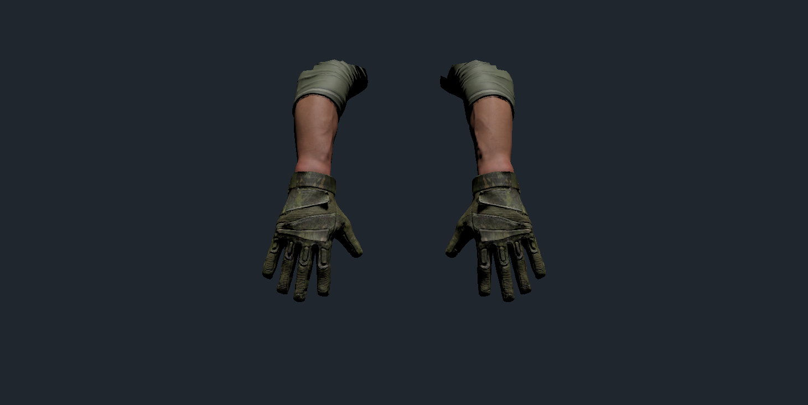
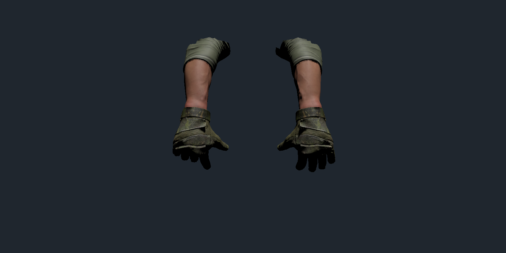

# 军人手套手臂精简接入

2026-10-20；P3场景task014，BDD23与接口11追加范围。

## 交付

- 清理用户刚导入的 `Assets/AAAModularFPSArmsPack`（约8.26GB），从原包选一套迷彩手套和深色袖子；使用无纹身皮肤。
- 精简为两只独立前臂蒙皮网格、3个共享URP材质、10张1024贴图，资源约11.6MB。没有保留整包FBX、其他手套/衣服、身体、手表、演示场景或PSD。
- 选定资源先导出到项目的 `TempAssetResearch` 暂存目录（Assets 之外），再删除原整包和中间产物，只重新导入15个必要资源。用户的下载目录unitypackage完整保留。
- 原 `VirtualHand_Left/Right.prefab` 路径和GUID保留，替换其模型并配置手指姿势。模式一、二场景的旧模型实例也已替换并保存；主菜单、模式三/四的动态安装仍使用同一资源入口。
- 保留既有手柄跟随、武器附着、握枪门禁和换弹逻辑；骨骼弯曲轴适配为现有表现代码的X轴。场景生成工具亦接入新手模型，防止重新生成后恢复旧模型。

## 检查与限制

- Unity脚本编译无失败；精简资源依赖中对原整包目录引用数为0，原整包目录已不存在。
- 已查看最终导入的张手外观与蒙皮握姿预览，材质正常，无粉色。握姿截图使用现有表现输入入口设置后由SkinnedMeshRenderer.BakeMesh生成编辑器预览；没有作为运行时静态网格保存。
- 两手各有15个可识别手指关节；从张手到握姿，蒙皮顶点最大位移约左9.8cm、右15.2cm。
- 现有两场景的左右手均指向 `ModularGlovedArm_Left/Right` 网格。
- 本次未新增或运行自动化测试，未进行VR实机验收。需在头显中检查手柄位置、双手握枪手指贴合、换弹左手动作及动画结束恢复控制，性能效果也需实机确认。后续获授权后补入现有手部/换弹PlayMode回归。
- 旧手Prefab备份与精简重导包位于 `TempAssetResearch/ModularArmsBackup`；该研究目录不提交Git。

