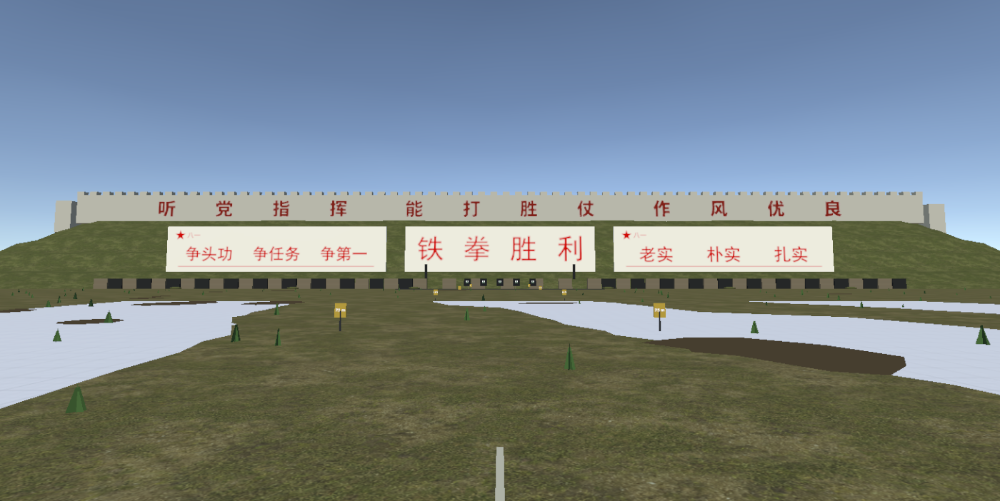
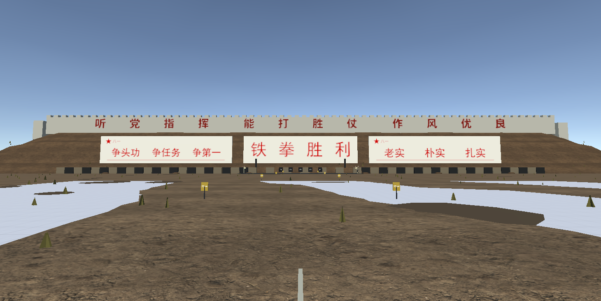

# 模式一/二左右背景标语

2026-10-20，P1场景task016 / P2场景task006，追溯BDD00与接口11的“左右背景标语板”。

- 两场景各加入左右白底红字板，左“争头功 争任务 争第一”，右“老实 朴实 扎实”；左上角均有红色五角星和“八一”。
- 中心位置x=-53/+53、y=9.38、z=110.9，板宽52高10.8；保留中央铁拳胜利、射击点、路线与上方既有标语。
- 使用共享贴图与材质，每板一个背景网格及一个文字网格，不带Collider和运行脚本；文字保留深度遮挡。
- `RangeSideSloganAuthoring.ApplyToExistingScenes()` 增量写入现有场景；两个场景生成工具均接入同一配置。字体图由`SideSlogansSource~/generate.py`确定性生成，五角星由几何顶点绘制，没有使用参考照片上的水印或其他内容。
- 已查看两个场景的实际编辑器渲染，文字顺序、朝向和红白配色正常，未挡住靶区。截图相机位置(0,2,8)，朝向(0,9,111)，属于环境预览，不是头显实机截图。
- 本次未新增或运行自动化测试。真实卧姿头显的远距离可读性仍待实机确认；补测计划见BDD00。

